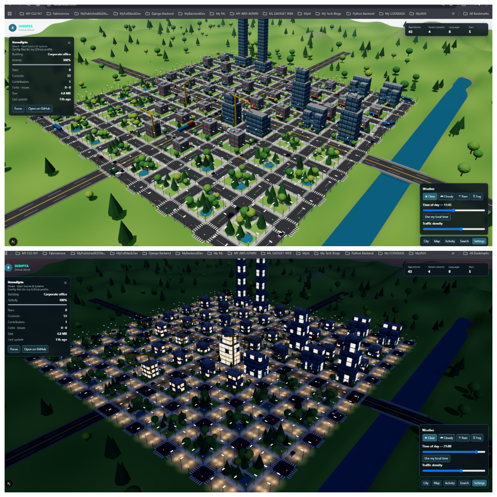

# GitHub World

GitHub World turns your GitHub repositories into an interactive 3D city. Each
repository becomes a building, and its language, size, stars, and recent
activity influence where it appears and how it looks. Recent commits are
visualized as construction activity around the city.

The app runs in demo mode when no GitHub token is configured, so it can be
explored without connecting an account.

> This is a casual side project built with the help of Claude, explored with a child
> developer's curiosity. Please do not take it too seriously—just have fun and
> track your code and try to mess with the AI. This is not a vibe-coded project.

## Project Pictures

<p align="center">
  
</p>


## Features

- Loads repositories owned by the authenticated GitHub user.
- Organizes repositories into language-based districts:
  - AI & ML
  - Web
  - Backend
  - Open Source & Systems
- Displays repository statistics, including stars, forks, issues, size,
  contributors, and commits.
- Shows recent commit activity and highlights newly discovered repositories.
- Provides an interactive 3D camera, repository search, activity feed, and
  minimap.
- Simulates time of day, weather, traffic density, lighting, and city activity.
- Falls back to a fully usable demo city when GitHub access is unavailable.

## Contributing

Want to add a new and unique feature, fix something, or extend the city with
new districts, buildings, animations, or interactions? You are welcome to
contribute. First, create an issue describing your idea or proposed fix so it
can be reviewed. After your issue has been reviewed, you can open a pull
request with the implementation and a short description of what you changed.
All creative additions are welcome as long as they keep the project fun and
usable.


## Requirements

- Node.js 20.9 or newer
- npm
- A GitHub personal access token for live repository data (optional)

## Getting started

1. Install dependencies:

   ```bash
   npm install
   ```

2. (Optional) Create a `.env.local` file in the project root and add a GitHub
   token:

   ```env
   NEXT_PUBLIC_GITHUB_TOKEN=github_pat_your_token_here
   ```

   The token is used by the browser to authenticate GitHub API requests. Use a
   token with the minimum permissions needed to read the repositories you want
   to display. Do not commit `.env.local` or share the token.

3. Start the development server:

   ```bash
   npm run dev
   ```

4. Open [http://localhost:3000](http://localhost:3000).

Without `NEXT_PUBLIC_GITHUB_TOKEN`, the app starts in demo mode and displays
sample repositories.

## Available scripts

| Command | Description |
| --- | --- |
| `npm run dev` | Start the Next.js development server |
| `npm run build` | Create a production build |
| `npm run start` | Serve the production build |
| `npm run lint` | Run ESLint |

## Using the city

- Click a building to inspect its repository details.
- Use **Focus** in the details panel to move the camera to a repository.
- Use **Activity** to view active projects and recent commits.
- Use **Search** to find a repository by name.
- Use **Settings** to change weather, time of day, and traffic density.
- Use **Map** to open the larger city map.
- Press `M` to toggle the map.
- Press `Escape` to close the selected repository or map.
- Select **City** to return to the full-city view.

When live time is enabled, the scene follows the local time on the device.
Changing the time slider switches to manual time; choose **Use my local time**
to enable live time again.

## Data and API behavior

The client uses the GitHub REST API through Octokit. It loads the authenticated
user and their repositories, then polls for updates every 60 seconds. Recent
commit activity is read from the authenticated activity feed when available,
with recent repository commits used as a fallback.

Some repository details are fetched only after a building is selected. GitHub
API rate limits and network failures are handled by falling back to the demo
city or by showing the data that is already available.

## Project structure

```text
app/
  page.tsx          Application state and GitHub data loading
  globals.css       HUD and application styles
components/
  World.tsx         Three.js scene composition
  Hud.tsx           Controls, panels, statistics, and minimap
  Building.tsx      Repository buildings
  ...               Camera, lighting, terrain, people, and vehicles
lib/
  world.ts          City layout, repository classification, and activity logic
  env.ts            Shared scene environment state
```

## Production build

To verify and build the application for production:

```bash
npm run lint
npm run build
npm run start
```

The production server also reads `NEXT_PUBLIC_GITHUB_TOKEN` from the
environment at build/runtime according to the deployment platform's
configuration.
